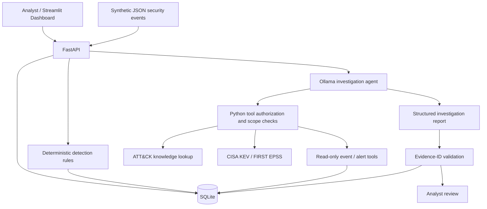

# SentinelAI Enterprise
### Agentic SOC Investigation & AI Security Validation — Local Research Prototype

**SentinelAI Enterprise** is a Python-based security operations lab that ingests structured security events, generates explainable detection alerts, and uses a locally hosted LLM to investigate evidence through **bounded, read-only tools**. It combines defensive security automation with practical **AI security engineering**: tool authorization, per-alert scope enforcement, audit logging, and adversarial evaluation.

> **Status:** Functional local prototype; not production-ready. Uses synthetic demonstration events. AI conclusions require analyst verification. No autonomous remediation is performed.

## Why this project matters

Security teams need to correlate evidence, enrich alerts, and document findings without allowing AI systems to take unauthorized actions. SentinelAI demonstrates both **AI for security** (investigations and enrichment) and **security for AI** (constraining agent tools and validating outputs).

### Features verified in the repository

| Capability | Implementation |
| --- | --- |
| Security event ingestion | FastAPI endpoint accepting validated JSON batches (up to 500 events) |
| Event persistence | SQLite tables for events, alerts, investigations, and audit records |
| Rule-based detection | Failed-login window (≥5 failures within 5 minutes, grouped by host/user/source) and encoded PowerShell command indicators |
| ATT&CK mapping | T1110 (Brute Force), T1059.001 (PowerShell) |
| Agentic investigation | Ollama model-directed tool requests, bounded by a tool-call budget and deadline |
| Tool security | Python-enforced allowlist, argument validation, per-alert scope checks, denied-call auditing |
| Evidence-based reports | Pydantic schema validation and rejection of event IDs outside the alert evidence set |
| Threat intelligence | CISA Known Exploited Vulnerabilities and FIRST EPSS lookups; upstream failures reported |
| Analyst interface | Streamlit overview, JSON upload, investigation, and CVE lookup |
| Reproducible checks | Pytest, synthetic detection evaluation, two-scenario live LLM evaluation, GitHub Actions |
| Packaging | Docker Compose for API and dashboard; Ollama runs separately |

**Not implemented:** trained ML anomaly detection, vector-database RAG, full NVD/CVSS enrichment, authentication/RBAC, live SIEM integrations, and production deployment controls. The knowledge-search tool currently searches a small built-in ATT&CK-oriented reference dictionary, **not** a vector RAG index.

## Architecture



The model can *request* tools, but Python decides whether each request is permitted. The agent does not receive shell execution or alert-modification tools.

## Technology stack

**Python 3.12**, FastAPI, Pydantic, SQLite, Streamlit, Ollama (`llama3.2:3b`), Requests, Pytest, Docker Compose, and GitHub Actions.

## Getting started (Windows 11 + Ubuntu WSL2)

### Prerequisites

- Ubuntu 24.04 under WSL2 (or a compatible Linux environment)
- Python 3.12, `python3.12-venv`, Git, and `curl`
- [Ollama](https://docs.ollama.com/) installed and running, with `llama3.2:3b` downloaded
- Optional: [Docker Desktop](https://docs.docker.com/desktop/) with WSL integration

Install Linux dependencies if needed:

```bash
sudo apt update
sudo apt install -y python3.12 python3.12-venv git curl
```

On the machine running Ollama:

```bash
ollama pull llama3.2:3b
ollama list
```

### Local installation

From the **repository root**:

```bash
python3.12 -m venv .venv
source .venv/bin/activate
python -m pip install --upgrade pip
python -m pip install -r requirements.txt
python -m pytest -q
```

Start the backend in terminal A:

```bash
source .venv/bin/activate
uvicorn app.main:app --reload --host 127.0.0.1 --port 8000
```

Start the dashboard in terminal B:

```bash
source .venv/bin/activate
streamlit run app/dashboard.py --server.address 127.0.0.1
```

Open the local dashboard at `http://127.0.0.1:8501` or API docs at `http://127.0.0.1:8000/docs`. These are **local addresses**, not hosted demos.

> **Ollama connectivity:** From the environment running FastAPI, check `curl http://127.0.0.1:11434/api/tags`. If Ollama runs on Windows and the API runs in WSL, local networking behavior can vary. Configure `OLLAMA_URL` only for a trusted reachable endpoint; do not expose the unauthenticated Ollama API publicly.

### Environment variables

Copy `.env.example` to `.env` for reference. The application reads environment variables; it **does not automatically load** `.env` with a dotenv loader.

| Variable | Default / purpose |
| --- | --- |
| `SENTINEL_DB` | `./data/sentinelai.db` — SQLite database location |
| `OLLAMA_URL` | `http://127.0.0.1:11434` — local model API |
| `OLLAMA_MODEL` | `llama3.2:3b` — Ollama model |
| `SENTINEL_API` | `http://127.0.0.1:8000` — dashboard backend URL |

To override a value in Ubuntu, use `export OLLAMA_URL=...` **before** starting the API.

## Hands-on walkthrough: investigate a suspicious event

All commands below run from the repository root while the API is running.

**1. Check health:**

```bash
curl http://127.0.0.1:8000/health
```

Expected: `{"status":"ok"}`.

**2. Import the synthetic sample:**

```bash
curl -X POST http://127.0.0.1:8000/events/import \
  -H "Content-Type: application/json" \
  --data-binary @sample_data/suspicious_events.json
```

A **fresh database** should import 7 events and generate 2 alerts. Repeated imports persist additional events, so later counts may differ.

**3. Review alerts:**

```bash
curl http://127.0.0.1:8000/alerts
```

The sample should trigger T1110 and T1059.001 detections. These are indicators requiring investigation, **not confirmed attacks**.

**4. Investigate an alert with the local LLM:**

```bash
curl -X POST http://127.0.0.1:8000/alerts/1/investigate
```

Replace `1` with an actual ID returned by `/alerts`. The agent may call approved tools, then generates a structured report with hypotheses, alternative explanations, event references, next steps, and limitations.

**5. Review persisted investigations:**

```bash
curl http://127.0.0.1:8000/investigations
```

**6. Retrieve exploitation intelligence:**

```bash
curl http://127.0.0.1:8000/intelligence/CVE-2021-44228
```

This looks up **KEV membership and EPSS**. It does **not** verify that any specific asset is vulnerable, or retrieve full NVD severity data.

## API reference

| Method | Endpoint | Purpose |
| --- | --- | --- |
| GET | `/health` | Application health |
| POST | `/events/import` | Import structured security events |
| GET | `/events` | List recent events |
| GET | `/alerts` | List recent alerts |
| POST | `/alerts/{alert_id}/investigate` | Run bounded agentic investigation |
| GET | `/investigations` | List saved investigation reports |
| GET | `/intelligence/{cve}` | Look up CISA KEV and FIRST EPSS |

Use `/docs` for the interactive OpenAPI interface.

## AI security model

### Agent tools

The Ollama agent may request only the following functions:

| Tool | Purpose |
| --- | --- |
| `get_alert` | Read selected alert metadata |
| `get_events` | Read evidence attached to the selected alert |
| `get_related_alerts` | Retrieve recent alert summaries |
| `search_knowledge` | Search a small built-in ATT&CK knowledge dictionary |
| `lookup_cve` | Retrieve KEV/EPSS data for a valid CVE |

The Python backend enforces an allowlist, strict tool arguments, and a **per-alert scope** for alert-related calls. Investigations have a bounded tool-call budget; tool activity and denied attempts are audited. The model has no authorized arbitrary command execution or remediation tool.

### Prompt-injection and evidence controls

Log messages and tool results are **untrusted inputs**. The system instructs the model not to follow instructions embedded in evidence. Reports are schema-validated, and referenced event IDs must belong to the selected alert. **These safeguards do not prove that every generated claim is accurate or that all prompt injections fail.**

For security testing, `scripts/evaluate_llm.py` compares a baseline scenario against a synthetic log containing an injected instruction. Review the output manually for semantic influence, not only valid IDs.

## Testing and evaluation

```bash
# Automated unit/integration-style tests; Ollama not required for mocked tests
python -m pytest -q

# Deterministic smoke test: 7 synthetic events and expected detection techniques
python -m scripts.evaluate

# Two live LLM scenarios; requires a reachable Ollama model
python -m scripts.evaluate_llm
```

**Interpretation:** The deterministic evaluation checks expected detections on a single synthetic scenario. It is **not** a benchmark of detection precision or recall in production. The live LLM evaluation collects latency, tool traces, and evidence-reference validity; two scenarios are insufficient to establish prompt-injection resistance. Report measured results only after executing the scripts in your own environment.

For a stronger research artifact, add 20–30 labeled investigation scenarios, a reference answer for each, manual or rubric-based grading of unsupported claims, and a before/after prompt-injection attack success rate.

## Docker Compose

Stop local backend/dashboard processes before starting the containers:

```bash
docker compose up --build -d
docker compose ps
docker compose logs api
docker compose logs dashboard
```

Open the dashboard at `http://127.0.0.1:8501`.

The API and dashboard ports are bound to localhost in `compose.yaml`. Docker uses `http://host.docker.internal:11434` for Ollama; host connectivity must be verified on your machine. Database state is stored in the named Docker volume `sentinel_data`.

Stop without deleting the database volume:

```bash
docker compose down
```

**Do not publish this application to an untrusted network:** there is no API authentication, user identity enforcement, or rate limiting.

## Repository layout

```text
app/                 FastAPI, SQLite, detection, agent, threat intelligence, dashboard
scripts/evaluate.py  Deterministic synthetic detection smoke test
scripts/evaluate_llm.py  Two live Ollama investigation scenarios
tests/               Pytest tests for API behavior, tool scope, and validation
sample_data/         Synthetic security events for a repeatable demonstration
docs/FINAL_CHECKLIST.md  Demo and validation checklist
.github/workflows/   GitHub Actions CI
Dockerfile           API/dashboard container image
compose.yaml         Local container services
.env.example         Environment-variable reference
```

## Current limitations and responsible use

- **Local educational prototype only**: no authentication, authorization by user identity, rate limiting, or production-grade isolation.
- The dashboard checks upload size in its UI, but the backend does not enforce a complete request-body size limit.
- Events are synthetic; rules may generate false positives. Detection coverage is intentionally narrow.
- AI output can be incorrect or manipulated by untrusted text; only event-ID membership is mechanically validated.
- `search_knowledge` is keyword matching over a small in-code dictionary, **not** vector search or full retrieval-augmented generation.
- No trained ML detector, automatic remediation, SIEM integration, or complete vulnerability scanner is included.
- CVE intelligence depends on external services and may be unavailable.
- Dependency ranges are not fully pinned; production-style supply-chain controls remain future work.
- Only use non-sensitive, authorized test data. Never upload secrets, personal records, or real production logs to an unsecured prototype.

## Roadmap

1. Add API authentication, per-user investigation authorization, request-size limits, and rate limiting.
2. Create a labeled evaluation set for prompt injection, unsupported claims, and investigation accuracy.
3. Implement cited retrieval over curated ATT&CK and incident-response references; evaluate retrieval quality.
4. Add NVD/CVSS and asset-specific vulnerability context with verified version matching.
5. Add real SIEM data ingestion and robust detection metrics.
6. Introduce deployment hardening, dependency pinning, observability, and documented security reviews.

## Sources and technical references

These authoritative references inform the design. **They are documentation and research sources, not endorsements of this project.**

### Defensive security and incident response
- [NIST SP 800-61 Rev. 3 — Incident Response Recommendations](https://csrc.nist.gov/pubs/sp/800/61/r3/final): Incident response lifecycle and operational practices.
- [MITRE ATT&CK — Enterprise Matrix](https://attack.mitre.org/matrices/enterprise/): Adversary tactics and techniques.
- [MITRE T1110 — Brute Force](https://attack.mitre.org/techniques/T1110/): Context for repeated authentication failures.
- [MITRE T1059.001 — PowerShell](https://attack.mitre.org/techniques/T1059/001/): Context for suspicious PowerShell execution.

### AI and agent security
- [OWASP Top 10 for LLM Applications](https://genai.owasp.org/llm-top-10/): Prompt injection, insecure output handling, and excessive agency.
- [NIST AI Risk Management Framework](https://www.nist.gov/itl/ai-risk-management-framework): Governance and evaluation of AI-related risks.
- [MITRE ATLAS](https://atlas.mitre.org/): Adversarial threats and techniques targeting AI systems.
- [Ollama API documentation](https://docs.ollama.com/api): Local LLM chat and tool-calling integration.

### Threat and vulnerability intelligence
- [CISA Known Exploited Vulnerabilities Catalog](https://www.cisa.gov/known-exploited-vulnerabilities-catalog): Evidence of known exploitation.
- [FIRST Exploit Prediction Scoring System](https://www.first.org/epss/): Exploitation likelihood estimates.
- [NVD API documentation](https://nvd.nist.gov/developers/vulnerabilities): Future CVE/CVSS enrichment; **not yet integrated**.

### Engineering and testing
- [FastAPI documentation](https://fastapi.tiangolo.com/): Python API design and OpenAPI documentation.
- [Pydantic documentation](https://docs.pydantic.dev/latest/): Input and structured-output validation.
- [Streamlit documentation](https://docs.streamlit.io/): Interactive dashboard.
- [Docker Compose documentation](https://docs.docker.com/compose/): Local container orchestration.
- [Pytest documentation](https://docs.pytest.org/en/stable/): Automated tests.
- [GitHub Actions documentation](https://docs.github.com/en/actions): CI workflows.

## Project scope

Built as a practical **AI-for-cybersecurity and cybersecurity-for-AI** portfolio demonstration. The goal is to make investigation behavior inspectable, testable, and constrained—not to replace a human SOC analyst.
